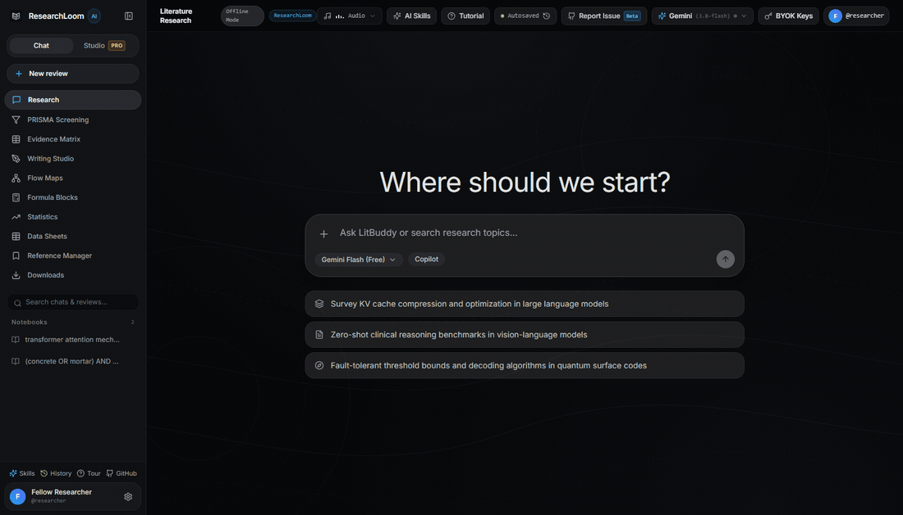
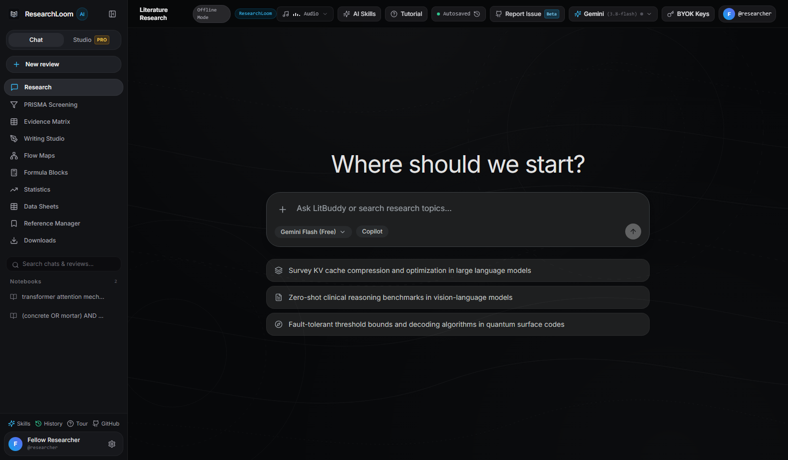
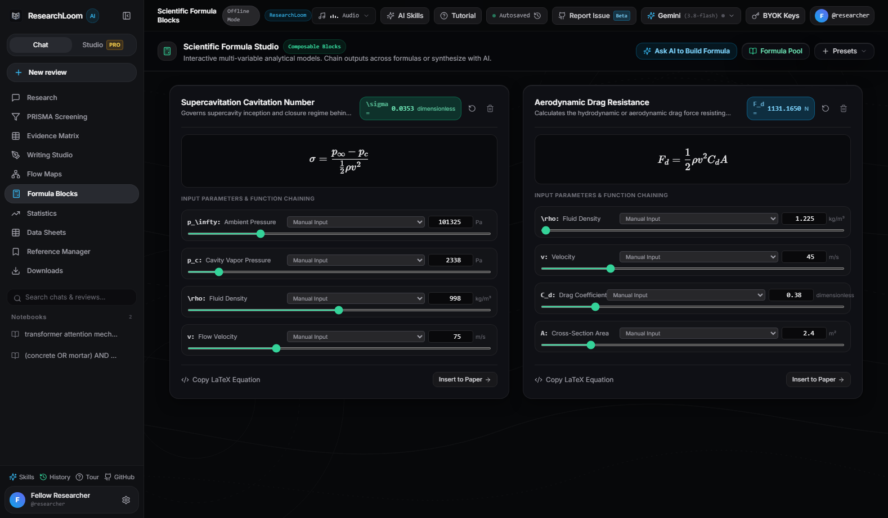
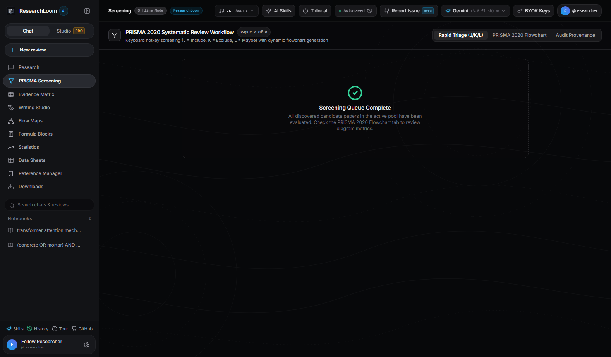
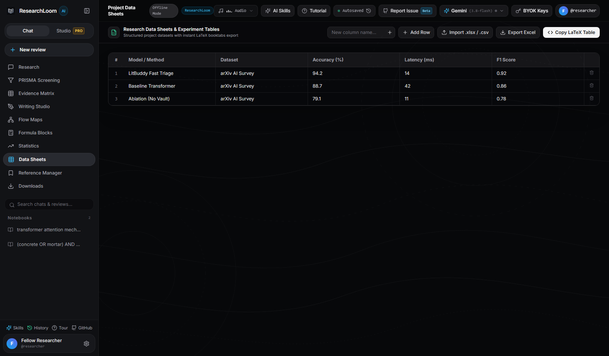
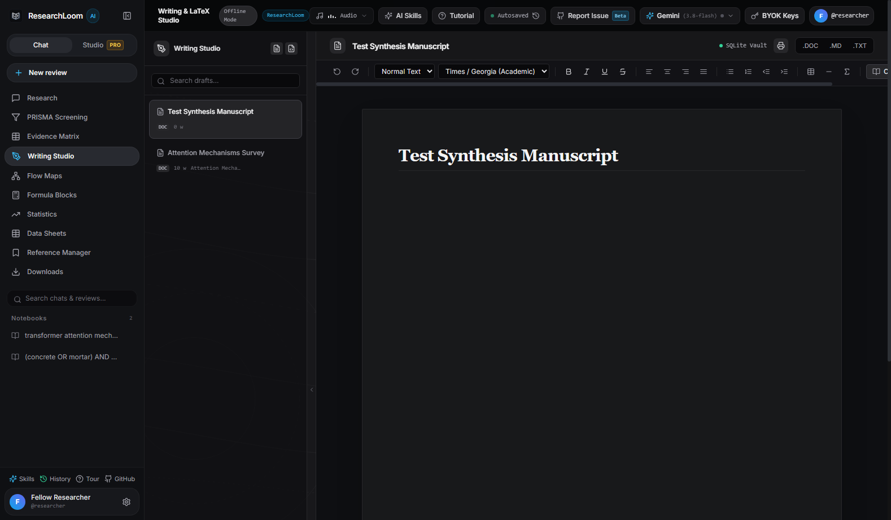

# ResearchLoom (Samhita / संहिता)

**ResearchLoom** (also known as **Samhita** — from Sanskrit *संहिता*, meaning *"methodically gathered and joined together"*) is an autonomous academic literature synthesis engine, flow canvas explorer, and interactive research workbench. It discovers scientific literature across open academic indexes, deduplicates candidate records, executes a two-stage relevance triage and extraction pipeline, archives full-text PDFs into a private local document vault, and provides an interactive research assistant with KaTeX formula rendering and LaTeX manuscript authoring. Users can freely toggle their preferred workspace identity between **ResearchLoom** and **Samhita** anytime in the application profile settings.

---

## Live Walkthrough Demo



> A complete high-resolution MP4 video walkthrough is also available at [`docs/demo/researchloom_demo.mp4`](docs/demo/researchloom_demo.mp4).

---

## Screenshots & Visual Walkthrough

### 1. Literature Discovery & Candidate Search


### 2. Scientific Formula Blocks & Model Chaining


### 3. Systematic Review & PRISMA 2020 Screening


### 4. Interactive Data Sheets & Experiment Tables


### 5. Writing Studio & Academic Manuscript Editor


---

## Architecture Overview

```
                                  [ User Query ]
                                         |
                                         v
   +--------------------------------------------------------------------------+
   |                       Academic Discovery Cascade                         |
   |   OpenAlex Polite Pool | arXiv API | Crossref | Europe PMC | DOAJ        |
   +--------------------------------------------------------------------------+
                                         |
                                         v
   +--------------------------------------------------------------------------+
   |                      Deduplication & Pre-Filtering                       |
   |              Normalized DOI matching & Alphanumeric Hashing              |
   +--------------------------------------------------------------------------+
                                         |
                                         v
   +--------------------------------------------------------------------------+
   |                      Two-Stage Synthesis Pipeline                        |
   |   Stage 1: Batch Abstract Triage (Relevance scoring 1-5 & rationale)     |
   |   Stage 2: Section Slicing & Deep Extraction (Problems, methods, gaps)   |
   +--------------------------------------------------------------------------+
                                         |
                    +--------------------+--------------------+
                    |                                         |
                    v                                         v
   +----------------------------------+     +----------------------------------+
   |      Local Document Vault        |     |     Interactive Chat Assistant   |
   |  In-app PDF retrieval & viewer   |     |  Grounded Q&A, KaTeX rendering,  |
   |  Saved to 'ResearchLoom Papers'  |     |  clickable citation pill badges  |
   +----------------------------------+     +----------------------------------+
```

---

## Features

- **Multi-Engine Academic Discovery**: Searches OpenAlex (100,000 requests/day polite pool), arXiv API, Crossref, Europe PMC, and DOAJ without requiring paid academic subscriptions.
- **Two-Stage LLM Evaluation**:
  - **Stage 1 (Batch Triage)**: Evaluates batches of candidate abstracts simultaneously using lightweight, fast models (Groq Llama 3.1 8B or Gemini Flash 8B).
  - **Stage 2 (Deep Extraction)**: Extracts core research questions, methodologies, empirical benchmarks, and research limitations into structured schemas.
- **Local Document Vault (`ResearchLoom Papers`)**: Downloads and caches full-text papers directly inside a local folder on your computer. Includes an inline in-app PDF reader.
- **Interactive Research Chatbot**: Context-grounded conversational interface for asking detailed questions across the synthesized paper collection, with dynamic KaTeX LaTeX rendering and clickable citation badges.
- **Reference Manager**: Exports formatted references across BibTeX, APA, MLA, and RIS formats, as well as Excel (`.xlsx`) and CSV tables.
- **Bring Your Own Key (BYOK) Security**: API keys are encrypted locally using AES-256 via Fernet cryptography in SQLite. No keys are hardcoded or shared.

---

## Project Structure

```text
researchloom/
├── backend/
│   ├── app/
│   │   ├── main.py              # FastAPI entrypoint and middleware configuration
│   │   ├── config.py            # Environment configuration and settings
│   │   ├── db/                  # SQLite schema and session lifecycle
│   │   ├── models/schemas.py    # Pydantic data models and validation contracts
│   │   ├── services/            # Search cascades, PDF slicing, LLM drivers, vault
│   │   └── routers/             # API endpoints (review, vault, assistant, auth)
│   ├── requirements.txt         # Python dependencies
│   ├── Dockerfile               # Container build definition
│   └── litbuddy_app.py          # Native desktop application entrypoint (pywebview)
├── frontend/
│   ├── src/                     # React 18 + TypeScript user interface
│   │   ├── components/          # Tables, sidebars, PDF viewer, chat drawer
│   │   ├── services/            # API client and client-side Excel exporters
│   │   └── types/               # TypeScript interfaces
│   ├── package.json
│   └── vite.config.ts
├── netlify.toml                 # Production Netlify routing and deployment config
└── build_windows_exe.bat        # Automated Windows desktop build script
```

---

## Standalone Downloads & Multi-Platform Support

ResearchLoom (Samhita) is distributed as a lightweight, 100% offline-ready desktop application for both Windows and macOS:

### 1. Windows (10/11 64-bit)
- **Direct GitHub Releases**: [https://github.com/sohamsans/researchloom/releases](https://github.com/sohamsans/researchloom/releases)
- **Package Archive (Recommended)**: `ResearchLoom-v4.3.1-windows-x64.zip`
- **Standalone Binary**: `ResearchLoom.exe` (~110 MB, single executable, zero setup)

### 2. macOS (Apple Silicon M-Series & Intel)
- **macOS Disk Image**: Download `ResearchLoom-macOS-arm64.dmg` from the [Releases](https://github.com/sohamsans/researchloom/releases) page. Open the `.dmg` and drag `ResearchLoom.app` into your Applications folder.
- **Local Run (Alternative)**:
  ```bash
  git clone https://github.com/sohamsans/researchloom.git
  cd researchloom
  pip install -r backend/requirements.txt pywebview
  python backend/litbuddy_app.py
  ```

### Note on Unsigned App Prompts
Because ResearchLoom is a free open-source project without commercial corporate code-signing certificates:
1. **Windows SmartScreen**: Click **More info** and select **Run anyway**.
2. **macOS Gatekeeper**: On first launch, if macOS displays an unidentified developer prompt, right-click (or Control-click) `ResearchLoom.app` and choose **Open**, then confirm.
The software is 100% open-source with full code inspection available in this repository.

---

## Academic Downloading & Polite Pool Advisory

ResearchLoom makes research collection straightforward by querying open academic indexes (OpenAlex, arXiv, Crossref, Europe PMC, Unpaywall, IPFS, Project Gutenberg, and decentralized mirrors). However, please note:

1. **Academic Publisher Paywalls & Captchas**: Major commercial publishers frequently update bot detection and paywalls. While ResearchLoom exhaustively rotates across mirrors, some closed-access or copyright-restricted papers cannot be retrieved automatically. In these instances, researchers can obtain the document through their university library proxy or preferred repository and drag/import the PDF directly into ResearchLoom's local vault.
2. **API Polite Pools & Rate Limits**:
   - Services like OpenAlex and Unpaywall provide generous free access through a Polite Pool when a contact email is attached.
   - ResearchLoom uses a generic local identifier (`autolit@research.local`) by default so your personal email is never distributed to other users.
   - If you run intensive queries or distribute ResearchLoom widely, each user can supply their own contact email in their environment or settings without rate limit conflicts.

---

## Bug Reports, Maintenance & Community Guidelines

We welcome your feedback, ideas, bug reports, and collaborations!

### Issue Resolution Expectations
As a student, ongoing coursework, lab assignments, and academic projects take up substantial time. However, I am committed to maintaining this project diligently:
- **Minor Bugs & Fixes**: Typically triaged and resolved within 2 to 3 days.
- **Major Features & Enhancements**: Significant capability additions will generally take between 7 to 14 days to design, implement, and verify.
- **Always Free Policy**: The promise of ResearchLoom being free is forever. Any proposed feature that requires recurring subscriptions, paid backend servers, or would prevent the software from remaining 100% free and open will have to be skipped over.
- **Continuous Updates**: As I use ResearchLoom daily for my own research work, I will routinely publish refinements, mirror improvements, and workflow updates.

I hope this tool makes your research journey smoother and more productive. Suggestions, contributions, and academic collaborations are warmly welcomed.

*Your fellow researcher,*  
**sohamsans**

### How to Report an Issue
If you encounter any issues, layout quirks, or unexpected behavior:
1. Navigate to the **[GitHub Issues](https://github.com/sohamsans/researchloom/issues)** page.
2. Click **New Issue**.
3. **Attach screenshots** of the application window or affected views (Flow Maps, Writing Studio, Reference Manager, etc.).
4. Describe your operating environment, what you were trying to accomplish, and what occurred.
5. You can also click the **"Report Issue"** or **"GitHub"** buttons directly inside ResearchLoom's header bar or sidebar dock to jump to the issue tracker.

---

## Running Locally

### Option 1: Standalone Windows Application (`ResearchLoom.exe`)

You can run ResearchLoom as a native desktop application without installing Python or Node.js.

1. Compile the executable using the provided build script:
   ```cmd
   build_windows_exe.bat
   ```
2. The compiled binary will be placed at `dist/ResearchLoom.exe`.
3. Launch `ResearchLoom.exe`. It boots the local backend service and opens a dedicated native desktop window.
4. Downloaded papers are automatically saved to `ResearchLoom Papers/` in the same directory.

---

### Option 2: Running from Source

#### Prerequisites
- Python 3.11 or 3.12
- Node.js 18+ and npm

#### 1. Backend Setup

```bash
cd backend

# Create and activate virtual environment
python -m venv .venv

# On Windows:
.\.venv\Scripts\activate
# On Linux/macOS:
source .venv/bin/activate

# Install dependencies
pip install -r requirements.txt

# Start backend server
uvicorn app.main:app --reload --port 8000
```

The API service runs at `http://127.0.0.1:8000`. OpenAPI documentation is available at `http://127.0.0.1:8000/docs`.

#### 2. Frontend Setup

In a separate terminal:

```bash
cd frontend

# Install dependencies
npm install

# Start Vite development server
npm run dev
```

Open `http://localhost:5173` in your browser.

---

## Configuration

Copy `.env.example` in the `backend/` directory if you wish to configure default server settings:

```ini
DATABASE_URL=sqlite+aiosqlite:///./autolit.db
OPENALEX_EMAIL=your-email@example.com
RESEARCHLOOM_VAULT_DIR=./ResearchLoom Papers
```

API keys for LLM providers (Groq, Google Gemini, OpenRouter) can be entered directly in the application settings dialog upon startup. Keys are stored locally in an encrypted database.

---

## License

MIT License. See `LICENSE` for details.
