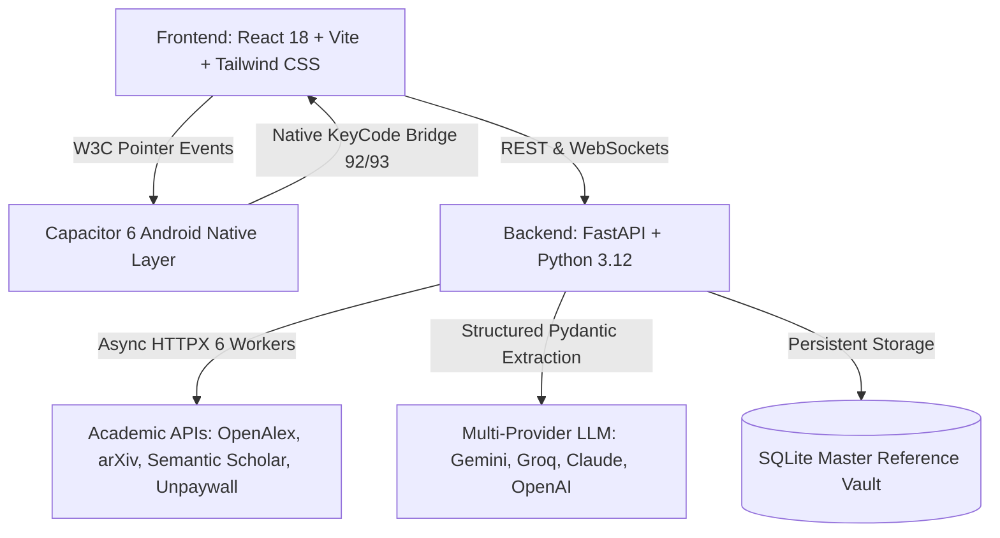

# Architecture & System Overview

ResearchLoom is built from the ground up for high-throughput academic discovery, local privacy, and low-latency interaction.

---

## 1. Core Subsystems

### A. Frontend Layer (`frontend/`)
- **Framework**: Vite + React 18 with TypeScript.
- **Styling**: Tailwind CSS adhering to strict anti-slop guidelines (dark obsidian `#07080a`, high contrast typography, zero generic neon gradients).
- **Stylus Engine**: HTML5 Canvas with Catmull-Rom cubic bezier smoothing, dual vector/raster erasure, and geometric shape recognition.
- **Flow Maps**: Infinite pan-zoom canvas with W3C Pointer Events, 2-finger multi-touch gestures, and dynamic force layouts.

### B. Backend Engine (`backend/`)
- **API Framework**: FastAPI running asynchronously on Python 3.12.
- **Academic API Connectors**: Robust rate-limited HTTPX clients with exponential backoff for OpenAlex Polite Pool, arXiv API, Semantic Scholar, and Unpaywall.
- **PDF Extraction Engine**: PyMuPDF (`fitz`) slicing targeted introductory and concluding sections up to 8,000 characters to conserve context tokens.

### C. Android Tablet Native Bridge (`frontend/android/`)
- **Capacitor 6 Native Container**: Wraps the web application into an offline-first Android package.
- **`MainActivity.java` Hardware Interception**:
  - Intercepts stylus hardware buttons (`KEYCODE_PAGE_UP` 92, `KEYCODE_PAGE_DOWN` 93, `BUTTON_STYLUS_PRIMARY`, `BUTTON_STYLUS_SECONDARY`).
  - Suppresses OEM overrides (blocking Xiaomi Notes and partial screenshot overlays while drawing).
  - Bridges physical clicks directly to the canvas via `window.handleStylusButton()`.
