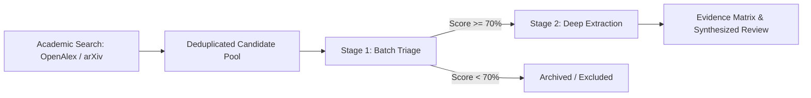

# Evidence Matrix & Two-Stage LLM Synthesis

ResearchLoom achieves fast, accurate, and cost-effective research triage through its strict **Two-Stage LLM Architecture**.

---

## 🎯 The Two-Stage Evaluation Pipeline

### Stage 1: Batch Triage
- **Input**: Truncated title and abstract (max 180 words per paper).
- **Execution**: Batches of 5 papers processed simultaneously using lightweight high-speed models (`gemini-2.0-flash` or Groq `llama-3.1-8b-instant`).
- **Output**: Strict JSON schema scoring relevance (0–100), core mechanism, and primary application.

### Stage 2: Deep Evidence Extraction
- **Input**: Targeted slices from the paper's Open Access PDF (Introduction, Methodology, and Conclusion, limited to 8,000 characters).
- **Concurrency**: 6 parallel workers streaming extractions simultaneously.
- **Output**: Quantitative metrics, statistical outcomes, sample sizes, and verbatim grounding quotes.

---

## 🔑 Multi-Provider BYOK Configuration

You can bring your own API keys for:
- **Google Gemini**: `gemini-2.0-flash`, `gemini-1.5-flash`
- **Groq Cloud**: `llama-3.1-8b-instant` (ultra-low latency)
- **Anthropic Claude**: `claude-3-5-sonnet`, `claude-3-5-haiku`
- **OpenAI**: `gpt-4o`, `gpt-4o-mini`
- **OpenRouter Free Tier**: DeepSeek, Mistral, and Llama community endpoints
